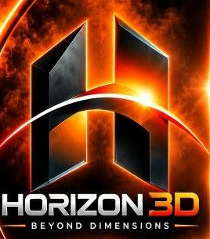

# HORIZON 3D — BEYOND DIMENSIONS

<div align="center">
  
  
  <h3>Transform your ideas into extraordinary 3D creations.</h3>
  <p><strong>A Next-Generation 3D Printing & Design Ecosystem</strong></p>
</div>

---

## 🌟 Overview

**HORIZON 3D** brings together powerful 3D printing tools, intelligent workflows, and precision control into one seamless experience. 

Designed with an ultra-premium Obsidian, Ember Orange (`#FF5A00`), and Silk Gold (`#FFD000`) industrial aesthetic, this platform features an end-to-end web slicer, real-time 3D CAD plate manipulation, online community 3D model library, and live 3D printer telemetry control.

---

## 🚀 Key Features

### 1. 🏛️ Library & Online Models Tab
- **Community 3D Models Catalog**: Explore curated 3D models with high-res previews, category filters, and community stats (likes, downloads, print times, filament weights).
- **Recent Projects**: Quick access to recently opened `.3mf` multi-component projects.
- **1-Click Model Extraction**: Instant "Open in Horizon Studio" action that imports models directly onto the slicer build plate.

### 2. 📐 Prepare / 3D CAD Plate Editor
- **Interactive Three.js 3D Viewport**: Orbit, pan, and zoom around a realistic 256×256mm Textured PEI Plate with coordinate grid lines and orientation triad (X-red, Y-green, Z-blue).
- **Full CAD Design & Plate Manipulation Tools**:
  - **Move (Translate)**: Granular X, Y, Z millimeter adjustments with Center Plate & Snap-to-Bed shortcuts.
  - **Rotate**: Pitch, Roll, Yaw controls with +90° quick snap presets.
  - **Scale**: Uniform & non-uniform axis scaling in millimeters and percentages.
  - **Add CAD Primitives**: Calibration Cube, Cylinder/Vase, Sphere, Torus Ring, Parametric Gear, and Cone.
  - **Planar Cut**: Visual interactive translucent orange cutting plane with Z-height slider and split modes (Keep Both, Lower, Upper).
  - **3D Text Emboss**: Custom text embossed onto 3D surfaces with adjustable depth.
  - **AMS Multi-Color Filament Painting**: Color parts using AMS slots 1 through 4.
  - **Mesh Wireframe Inspection**: Toggle polygonal tessellation overlay.
- **Slicing Engine**:
  - Fine profiles (0.12mm layer height, gyroid infill, speed controls, tree support).
  - Toolpath simulation with live progress and layer calculation.
  - One-click **"Send to 3D Printer"** dispatch.

### 3. 🖨️ Device Live Telemetry & Control
- **Printer Status**: Telemetry for connected 3D printer (`3DP-039-163 - Online`).
- **Live Chamber Camera Stream**: Real-time HUD view with fullscreen expansion.
- **Thermal Sensors**: Real-time readouts for Nozzle (220°C), Heated Bed (60°C), and Chamber (38°C).
- **Circular Jog Motion D-Pad**: Intuitive circular motion controller with +Y, -Y, +X, -X dial, Home center, 1mm/10mm steps, and Bed Z height elevator.
- **Active Hardware Controls**: Part cooling fan slider, chamber lamp switch, and extruder feeder.
- **Print Progress**: Real-time layer tracking, time remaining estimates, pause/resume, and stop controls.

---

## 🛠️ Tech Stack

- **Framework**: React 19 + TypeScript
- **Styling**: Tailwind CSS v4
- **3D Graphics & WebGL**: Three.js (`three`, `@types/three`)
- **Icons**: Lucide React (`lucide-react`)
- **Animation**: Framer Motion
- **Router**: TanStack Router
- **Build Tool**: Vite 6

---

## 📦 Getting Started

### Prerequisites

- Node.js (v18 or higher recommended)
- npm or pnpm

### Installation

```bash
# Clone the repository
git clone https://github.com/iitdetails-afk/horizon-3d.git
cd horizon-3d

# Install dependencies
npm install
# or
pnpm install
```

### Development Server

```bash
npm run dev
# or
npx vite --host
```

Open [http://localhost:5173](http://localhost:5173) in your browser.

### Production Build

```bash
npm run build
```

---

## 📄 License

Proprietary © HORIZON 3D. All rights reserved.
